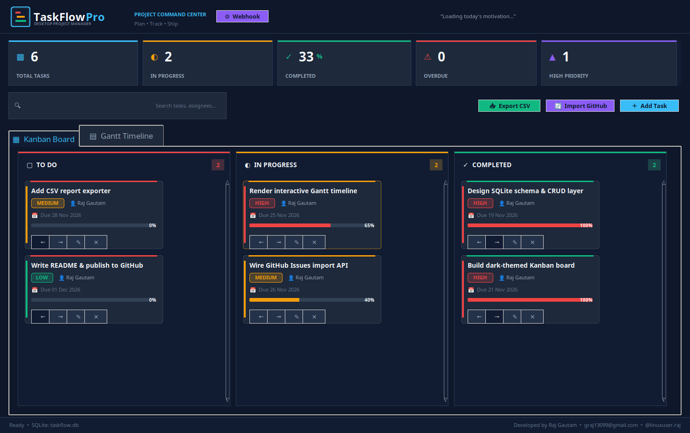
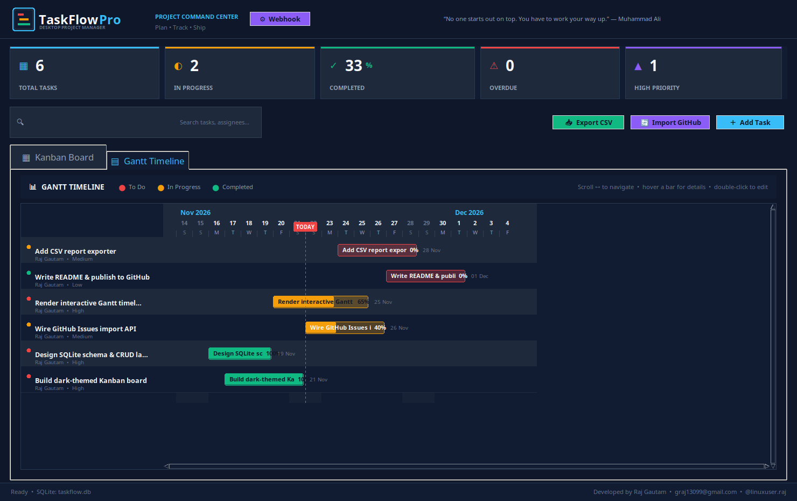
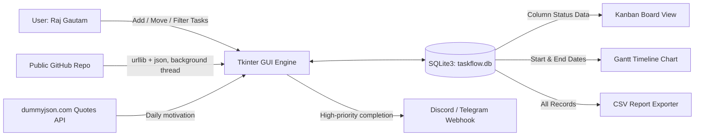

<div align="center">


<br/>


<br/>


<br/>

### 🚀 A professional, offline-first Desktop Project Management Tool
**Kanban Board • Interactive Gantt Timeline • Live KPIs • GitHub Issue Import • CSV Reports**

Built with **100% Python standard library** — no `pip install`, no heavy frameworks, no bloat.

</div>

---

## 📸 Application Preview

| Kanban Workflow Board | Interactive Gantt Timeline |
| :---: | :---: |
|  |  |

> Screenshots are captured from the real running app. Run `python3 main.py` and use the in-app tabs.

---

## ✨ Key Features

- **▦ Interactive Kanban Board** — Three-colour workflow (`To Do` 🔴 / `In Progress` 🟡 / `Completed` 🟢) with Canvas-drawn rounded task cards, priority badges, assignee, due date, progress bar, one-click `←` / `→` stage transitions, inline edit and delete.
- **📊 Visual Gantt Chart** — A native `tk.Canvas` timeline with month/day headers, weekend shading, task bars from start → end dates, graphical completion %, a red **TODAY** marker, hover tooltips, and smooth horizontal scrolling — without matplotlib or any plotting library.
- **📈 Live Analytics Header** — KPI cards for **Total Tasks**, **In Progress**, **Completed %**, **Overdue** and **High Priority** that refresh instantly after every change.
- **🔄 Real GitHub API Work** — Import open issues from any public repo (e.g. `Rg100152/taskflow`) using built-in `urllib.request` + `json` in a background thread. Bug/urgent labels map to High priority automatically; duplicate issues are skipped.
- **🔔 Webhook Alerts** — Configure a Discord/Telegram-compatible webhook; completing a High-priority task fires **“Task Completed by Raj Gautam!”** from a daemon thread.
- **💬 Daily Motivation** — Fetches a fresh developer quote from `dummyjson.com` on every launch (with an offline fallback).
- **📥 One-Click CSV Export** — Clean, timestamped project report with status, timeline, progress and a summary row.
- **⚡ Lightweight & Fast** — Pure stdlib (`tkinter`, `ttk`, `sqlite3`, `urllib`, `json`, `threading`, `csv`). Runs buttery-smooth on a **4GB RAM Pop!_OS laptop**.

---

## 🧩 System Data Flow (DFD)



---

## 🗂 Project Structure

```text
taskflow-pro-desktop/
├── main.py                     # Tkinter app shell, Canvas logo, KPIs, tabs, toolbar
├── database/
│   └── db_manager.py           # SQLite3 CRUD, schema, indexes & 6-task seeder
├── services/
│   └── github_api.py           # GitHub issues importer, quote fetcher, webhook notifier
├── ui/
│   ├── theme.py                # Dark theme tokens & Canvas drawing helpers
│   ├── kanban_view.py          # 3-column interactive Kanban board
│   ├── gantt_view.py           # Canvas-rendered interactive Gantt timeline
│   └── modals.py               # Add / Edit task, GitHub import & webhook dialogs
├── utils/
│   └── exporter.py             # CSV report generator
├── assets/
│   ├── banner.jpg              # Dark workspace banner (Unsplash, local copy)
│   ├── avatar.jpg              # Developer avatar (Unsplash, local copy)
│   ├── logo-taskflow.svg       # Crisp vector logo for GitHub / docs
│   ├── preview.png             # Kanban screenshot
│   └── preview-gantt.png       # Gantt screenshot
├── .gitignore
└── README.md
```

---

## 🛠 Run Locally (Pop!_OS / Linux / Windows)

```bash
git clone https://github.com/Rg100152/taskflow.git
cd taskflow
python3 main.py
```

**Requirements:** Python 3.8+ with Tkinter (bundled on Pop!_OS/Ubuntu; on Debian-like systems install `sudo apt install python3-tk` once). Nothing else.

Open directly in **Geany** and press **F5** — no virtualenv, no dependency step.

> On first run, `taskflow.db` is created automatically and seeded with 6 realistic developer tasks so both views are populated immediately.

---

## 🖱 Quick Usage Guide

| Action | How |
| :--- | :--- |
| Add task | Click **＋ Add Task**, fill fields, **Save Task** |
| Move stage | Click **←** / **→** on any card (progress auto-sets to 100% on Completed) |
| Edit task | Click the **✎** button or double-click a card / Gantt bar |
| Delete task | Click **✕** and confirm |
| Filter | Type in the search box (title, description or assignee) |
| Import issues | **🔄 Import GitHub** → enter `owner/repo` → **Import Issues** |
| Export | **📥 Export CSV** → choose a location |
| Alerts | **⚙ Webhook** → paste webhook URL |

---

## 👨‍💻 Developer

<div align="center">


<br/>

<b>Raj Gautam</b> — Developer & Linux Enthusiast

📧 graj13099@gmail.com &nbsp;•&nbsp; 📷 [@linuxuser.raj](https://instagram.com/linuxuser.raj) &nbsp;•&nbsp; 🐙 [Rg100152](https://github.com/Rg100152)

</div>

---

<div align="center">
  <sub>Built with Python standard libraries on Pop!_OS · © 2026 Raj Gautam · MIT License</sub>
</div>
